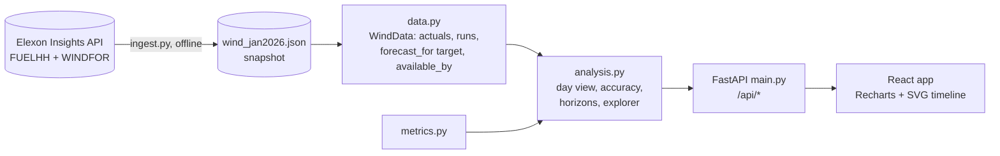

# Leeway: GB day-ahead wind forecast desk

A web app for a UK utility's day-ahead power buying team. For every delivery day it shows
**the wind forecast that was actually available when bids closed**, and it measures **how
accurate those forecasts have been**, turning the error into a safety margin the team can
plan with.

- **Live app:** https://gridbrick-project.vercel.app/
- **Video walkthrough:** _YOUTUBE_URL_
- Scope (from the brief): national GB wind, Elexon data only, purchase decisions made in January 2026.

---

## What it does

| Need from the brief | Where in the app |
| --- | --- |
| See the latest forecast available when the buy decision is made | **Day-ahead desk**: pick a delivery day and an auction; the run timeline shows every forecast run, the gate closure, and which run was the newest at that moment. The chart compares that forecast with actual outturn. |
| Quantify forecast error to decide with it | **Forecast accuracy**: MAE, RMSE, bias, error distribution, error by wind level and hour of day, a margin table per confidence level with an out-of-sample test, auction comparison, largest misses. **Forecast horizon**: error vs how far ahead the forecast was made (0-48 h), plus an explorer for any date range and horizon. |

### Headline results (EPEX SPOT hourly auction, bids close 09:20 on D-1)

- 744 delivery hours, 2 Jan to 1 Feb 2026, forecasts 17 to 40 hours ahead.
- Typical miss (MAE) **2.02 GW**, 18% of average output. RMSE 2.50 GW.
- The forecast ran **high by 1.75 GW on average**; wind came in below forecast in 85% of hours.
- To be covered on 90% of hours, plan on **forecast minus 4.15 GW**. Tested leave-one-day-out, that margin held in 88.6% of hours (95%: 5.27 GW, held 93.3%).
- Over-forecasting grows with wind level (bias +2.8 GW when the forecast is above 16 GW), consistent with wind farms being turned down when the grid is congested. These two datasets cannot confirm that; balancing-mechanism data would.
- Bidding at the later EPEX half-hourly auction (15:30) cuts the typical miss by about 7% (1.89 GW).
- Error rises steadily with horizon: MAE about 1.7 GW at 0-4 h, 2.3 GW at 48 h.

## How to run it

### Docker (one command)

```bash
docker compose up --build
# or: docker build -t leeway . && docker run --rm -p 8000:8000 leeway
```

Open http://localhost:8000. The container serves the API under `/api` and the built React app at `/`.
Interactive API docs: http://localhost:8000/api/docs

### Local development

Requirements: Python 3.12+, Node 22+.

```bash
# backend (terminal 1)
python -m venv .venv
.venv/bin/pip install -r requirements-dev.txt        # Windows: .venv\Scripts\pip
.venv/bin/uvicorn backend.app.main:app --reload --port 8000

# frontend (terminal 2)
cd frontend
npm ci
npm run dev                                           # http://localhost:5173, proxies /api to :8000
```

### Tests and checks

```bash
.venv/bin/pytest -q             # 28 tests: selection rules, metrics, API end to end
.venv/bin/ruff check . && .venv/bin/ruff format --check .
cd frontend && npm run lint && npm run build
```

### Refreshing the data

The app reads a snapshot in `backend/data/wind_jan2026.json`. To rebuild it from Elexon (no API key needed):

```bash
.venv/bin/python -m backend.app.ingest
```

## Files and directories

```
.
├── api/index.py               Vercel serverless entry point (wraps the FastAPI app)
├── backend/
│   ├── app/
│   │   ├── config.py          Analysis window, auction gate closures, confidence levels
│   │   ├── elexon.py          Elexon client for FUELHH (actuals) and WINDFOR (forecasts)
│   │   ├── ingest.py          CLI that downloads January 2026 data into the snapshot
│   │   ├── data.py            Snapshot loader + forecast selection rule + UK calendar helpers
│   │   ├── metrics.py         Error statistics (MAE, RMSE, bias, quantiles, histogram)
│   │   ├── analysis.py        Builds each view: day desk, accuracy report, horizon study, explorer
│   │   └── main.py            FastAPI routes under /api; serves the built frontend in Docker
│   ├── data/wind_jan2026.json Elexon snapshot: 1,632 half-hours of outturn, 280 forecast runs
│   └── tests/                 pytest suite (selection rules, metrics, API)
├── frontend/                  React + TypeScript + Vite
│   ├── src/App.tsx            Shell, tabs, shared controls, URL state
│   ├── src/api.ts             Fetch helper with a per-page cache and a useApi hook
│   ├── src/types.ts           TypeScript mirrors of the API responses
│   ├── src/format.ts          UK-time and GW/GWh formatting
│   ├── src/theme.ts           Chart colours and axis helpers
│   ├── src/components/        Run timeline (SVG), day chart, shared UI pieces
│   └── src/views/             Desk, Accuracy, Horizon, Method pages
├── Dockerfile                 Multi-stage: Node builds the frontend, Python serves everything
├── docker-compose.yml         One service on port 8000
├── vercel.json                Vercel services: FastAPI backend on /api/*, Vite frontend for the rest
├── .github/workflows/ci.yml   Lint, tests, frontend build, Docker build + smoke test
├── requirements.txt           Runtime Python dependencies
├── requirements-dev.txt       + pytest, ruff
├── ruff.toml, pytest.ini      Lint and test config
└── .python-version            Python 3.12 (used by Vercel)
```

## Architecture



- **Snapshot, not live calls.** The analysis window is fixed history, so the app reads a snapshot
  (690 KB) built by `ingest.py`. Responses are fast, numbers are reproducible, and Elexon is not
  called on every page view. API responses are marked cacheable at the CDN.
- **One rule for "available at decision time".** `WindData.forecast_for(target, available_by)`
  walks back from the newest run published by `available_by` and returns the first that covers
  the target. Day-ahead decisions use gate closure with a strict `<` (a run published at the
  gate is too late); the horizon study uses `target - N hours` inclusively. Tests assert that no
  delivery day ever uses a run published after its gate closure, for all three auctions.
- **No numpy/pandas at runtime.** The data is about 20k points, so plain Python keeps the
  serverless bundle small and cold starts quick.
- **Same app everywhere.** All routes live under `/api`. Locally Vite proxies them, on Vercel a
  rewrite sends them to the Python function, in Docker FastAPI also serves the static build.

### API

| Endpoint | Returns |
| --- | --- |
| `GET /api/meta` | Window, delivery days, auctions, confidence levels, snapshot details |
| `GET /api/day/{date}?gate=epex-60&confidence=0.9` | Decision-time forecast vs actual for one delivery day, band, firm line, all runs around it, day summary |
| `GET /api/accuracy?gate=epex-60` | All January decisions: summary, margins with backtest, histogram, by hour, by level, daily, worst hours, scatter, auction comparison |
| `GET /api/horizons` | MAE, RMSE, bias, P10/P90 error for horizons 0-48 h |
| `GET /api/explorer?start=&end=&horizon=` | Actual vs the forecast made at least `horizon` hours ahead, for a date range |
| `GET /api/docs` | OpenAPI / Swagger UI |

## Method and assumptions

- **Decision days** are 1-31 January 2026 (UK dates), so **delivery days** are 2 January to 1 February.
- **Gate closures** (UK time, day before delivery): EPEX SPOT GB hourly auction 09:20 (default),
  Nord Pool N2EX GB hourly auction 09:50, EPEX SPOT GB half-hourly auction 15:30.
- **Alignment:** WINDFOR is hourly, FUELHH half-hourly. Errors are scored on the hour against the
  settlement period starting at that hour. Nothing is interpolated for scoring.
- **Back-casts dropped:** WINDFOR runs include points before their own publish time; only points
  at or after the publish time count as forecasts.
- **Error = forecast - actual** (MW). Positive means the buyer is short of wind.
- **Margin at X%** = X-th percentile of the error. The day view's band (P10-P90) and firm line are
  computed leave-one-day-out, so a day never sees its own outcome. The accuracy page reports how
  often each margin held on unseen days.
- MAPE is not used (it explodes at low wind); MAE as a share of mean output is reported instead.
- **Limits:** one winter month of data; both datasets cover transmission-metered wind only.

## Development practices

- Small, typed modules with one job each; pure functions for metrics and selection so they are easy to test.
- 28 pytest tests, including a property-style check that no forecast is used after gate closure, and a
  clock-change test (23-hour UK day, BST gate closure).
- Ruff lint and format; TypeScript strict mode; oxlint for React.
- CI on every push: backend tests, frontend lint and build, Docker build and container smoke test.
- Configuration in one place (`config.py`); view state kept in the URL so any screen can be linked.

## Use of AI tools

I used **Claude Code** (Anthropic's AI coding assistant) while building this project: to explore
the Elexon API responses, scaffold the backend and frontend, write tests, and draft documentation.
I set the scope and the design decisions (which forecast counts at gate closure, how errors are
scored, the leave-one-day-out margin test), reviewed the code, and checked the numbers against the
raw Elexon data.

The walkthrough video was made with AI help as well. The narration is an AI voice generated from a
recording of my own voice (Coqui XTTS v2, run locally), and the screen recording of the live app and
the code was captured by an automated browser script. The numbers spoken in it come from the app.

## Deployment

`vercel.json` deploys the repository as two Vercel services: `backend` (the FastAPI app, entry point
`api/index.py`) receives every `/api/*` request, and `frontend` (the Vite build, served from the CDN)
receives everything else. The same repository also runs anywhere Docker runs.
